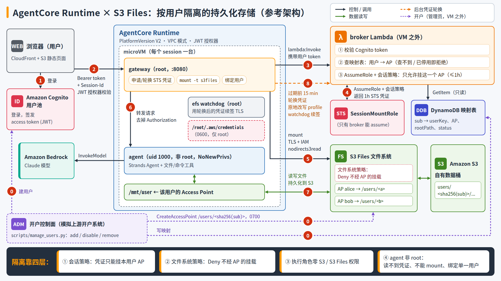

# AgentCore Runtime × S3 Files：按用户隔离的持久化存储（参考架构）

用户登录后，与运行在 Amazon Bedrock AgentCore Runtime 里的 agent 对话。每个 session 是一台独立的 microVM。在 session 的首个请求里，容器内以 **root** 运行的 gateway 会做三件事：

1. 拿用户的 token 找 broker，申请一份**只能挂载这个用户 access point** 的 STS 凭证；
2. 把这个用户的 S3 Files access point 挂到 `/mnt/user`；
3. 在后台定期**轮换**这份凭证。

agent 本身以**非 root（uid 1000）** 运行，只能读写 `/mnt/user`。写下的文件会持久化到客户自己的 S3 桶，换一个 session、换一台 microVM 依然可见，其他用户看不到。



本方案在 [walkley/acruntime-s3files-isolation](https://github.com/walkley/acruntime-s3files-isolation)（按 session 隔离；broker + 会话策略 + 文件系统策略兜底）的基础上，改成**按用户**隔离：开户时建 AP，容器内 root gateway 在首个请求里挂载，agent 降权运行，凭证自动轮换。每一条取舍见 [docs/design.md](docs/design.md)。

## 隔离靠什么

| 层 | 机制 | 挡住什么 |
|---|---|---|
| ① 会话策略 | broker 签发的 STS 凭证只允许 `s3files:AccessPointArn == 本用户 AP` | 拿着 alice 的凭证去挂 bob 的 AP |
| ② 文件系统策略 | 对不经 AP 的 `ClientMount/ClientWrite/ClientRootAccess` 显式 Deny | 绕过 AP 挂根目录，看到所有用户 |
| ③ 执行角色零权限 | Runtime 执行角色没有任何 S3 / S3 Files 权限；broker 只认有效的 Cognito token | VM 里的代码从 MMDS 拿执行角色去读桶 |
| ④ 非 root agent | agent 降权到 uid 1000 并设 `NoNewPrivs`；gateway 把 microVM 绑定到首个用户 | agent 读凭证文件、自己 mount、借别人的 session |

此外还有：身份用 Cognito JWT，AgentCore JWT 授权器和 broker 各校验一次；用户 ↔ AP 映射在开户时由控制面写入 DynamoDB，broker 只读；任何一步失败都拒绝服务，绝不退回执行角色或本地盘。

## 用户 ↔ AP 映射与管理

开户控制面 `scripts/manage_users.py` 在 VM 之外、以管理员身份运行，模拟上游的开户系统：

```bash
python3 scripts/manage_users.py add alice          # 建 Cognito 用户 + 建 AP(/users/<sha256(sub)>, 0700) + 写映射
python3 scripts/manage_users.py list               # 列出所有用户和各自的 AP
python3 scripts/manage_users.py disable alice      # 停用：broker 不再签凭证，下一次轮换或新会话挂载失败
python3 scripts/manage_users.py enable alice
python3 scripts/manage_users.py remove alice [--purge-data]
```

映射表 `<stack>-user-storage`：`sub → username, userKey, fileSystemId, accessPointId, rootPath, posixUid/Gid, status`。

broker 只有 `dynamodb:GetItem` 权限，没有任何 S3 Files 控制面权限。查不到记录或状态不是 `active`，就拒绝签发凭证。

## STS 凭证的申请与轮换

- **申请**：首个请求到达时，gateway 调 `lambda:Invoke`，把用户 token 交给 broker。broker 校验 token，查映射，然后带会话策略 `AssumeRole` SessionMountRole，返回最长 1 h 的凭证（role chaining 的上限）。gateway 把凭证写进 `/root/.aws/credentials [user-mount]`（0600），再执行 `mount -t s3files -o accesspoint=…,awsprofile=user-mount,nodirects3read`。
- **轮换**：gateway 的后台任务按凭证的实际过期时间，提前 `min(15 min, 剩余时间/4)` 重新申请，原地改写 profile，不重新挂载。efs-utils watchdog 续签 TLS 证书时会读到新凭证。如果某次轮换失败（例如 token 已过期），下一个请求带着新 token 到达时会立即重试。
- **演示**：侧边栏实时显示 AccessKeyId（掩码）、过期倒计时、轮换次数，另有「立即轮换 STS 凭证」按钮。

## 目录

```
infra/infra.yaml        CloudFormation：S3 桶、S3 Files（文件系统策略 + mount target）、Cognito、
                        DynamoDB 映射表、broker / SessionMountRole / 执行角色、ECR、
                        AgentCore Runtime（V2、VPC、JWT）、前端（S3 + CloudFront OAC）
infra/network.yaml      可选：测试 VPC（NAT + 2 个私有子网）
broker/handler.py       broker Lambda：校验 token → 查映射 → 签发会话策略限定的 STS 凭证
container/gateway.py    容器内 root gateway：申请凭证 → 挂载 → 绑定用户 → 轮换 → 代理
container/agent_app.py  非 root agent：降权 + NoNewPrivs → Strands Agent（文件 / 命令工具）
container/entrypoint.sh 进程编排：watchdog（守护重启）、日志转发、agent、gateway
frontend/               单页前端：Cognito 登录、对话、S3 存储侧边栏
scripts/deploy.sh       一键部署 / 更新
scripts/manage_users.py 用户开户与映射管理
scripts/e2e_test.py     端到端测试（隔离、攻击面、轮换、停用、持久化）
scripts/root_attack_test.py   最坏情况：在 alice 的 VM 里拿到 root，用她的凭证挂 bob 的 AP / 根目录
scripts/rotation_soak_test.py 长时间保活，验证后台自动轮换与 watchdog 续签
scripts/destroy.sh      一键销毁
docs/design.md          设计说明（决策、凭证、攻击路径、与 walkley 方案的对照）
docs/e2e-test-report.md 测试报告
```

## 部署

前提：AWS CLI v2（需要支持 `s3files`）、Docker（能构建 arm64 镜像）、Python 3.10+ 和 boto3；区域已支持 S3 Files 与 AgentCore Runtime（默认 `us-west-2`）；账号已开通 Claude 模型访问。

```bash
# 使用已有 VPC（两个私有子网须带 NAT，且位于 AgentCore 支持的 AZ，如 usw2-az1/az2/az3）
VPC_ID=vpc-xxx SUBNET_A=subnet-aaa SUBNET_B=subnet-bbb bash scripts/deploy.sh
# 或者让脚本新建一个测试 VPC
bash scripts/deploy.sh

python3 scripts/manage_users.py add alice
python3 scripts/manage_users.py add bob
```

脚本最后会打印前端地址（CloudFront）。可选环境变量：`STACK_NAME`（默认 `s3files-user`）、`REGION`、`CRED_TTL_SECONDS`（默认 3600，STS 允许的最小值是 900）。

## 演示脚本

1. 以 alice 登录。侧边栏会显示「正在唤醒 microVM，申请 STS 凭证并挂载你的 S3 存储…」，完成后显示挂载点、S3 位置、AP、凭证过期倒计时，以及 `uid 1000（非 root）`。
2. 让 agent「在工作区写一个 hello.md」。侧边栏的文件列表随即出现这个文件，下方标出它在 S3 上的 key。
3. 让 agent「执行 whoami 和 id，再试试读取 /root/.aws/credentials」，会看到 `uid=1000` 和 `Permission denied`。
4. 点「立即轮换 STS 凭证」，AccessKeyId 变化，轮换次数 +1，文件照常可读写。
5. 点「新会话（新 microVM）」，会唤醒一台全新的 microVM，`hello.md` 仍在：数据在 S3 上。
6. 退出后以 bob 登录：看不到 alice 的任何文件，AP 和 S3 前缀也不同。
7. （管理员）`manage_users.py disable alice` 之后，alice 再点「立即轮换」会失败，新会话也无法挂载；`enable` 后恢复。

## 测试

```bash
python3 scripts/e2e_test.py              # ~3 min
python3 scripts/root_attack_test.py      # 需要 InvokeAgentRuntimeCommand
python3 scripts/rotation_soak_test.py 70 # 70 min：自动轮换 + watchdog 用新凭证续签 TLS
```

`e2e_test.py` 覆盖：入口认证、映射与未开通用户、非 root 与凭证文件不可读、跨用户不可见、session 与用户绑定、执行角色的攻击面、broker 校验、STS 轮换、停用与恢复、跨 microVM 持久化、S3 对象可见、大模型对话写文件。结果见 [docs/e2e-test-report.md](docs/e2e-test-report.md)。

## 销毁

```bash
bash scripts/destroy.sh
```

依次删除各用户的 AP、broker、桶内对象和 CloudFormation 栈。Runtime 在 VPC 里的 ENI 释放较慢，如果删除安全组失败，稍后重跑即可。

## 踩过的坑

| 现象 | 原因 | 处理 |
|---|---|---|
| gateway 返回 403/503，客户端却收到 `424 Received error (403) from runtime`，原因丢失 | AgentCore 会把容器返回的非 2xx 包装成 424，并丢弃响应体 | gateway 的业务错误改为 HTTP 200 + `{"error","status"}`，前端按 `error` 字段处理 |
| 新 Runtime 版本之后的头几次挂载要 8–38 s（之后约 1 s） | V2 从快照恢复后，挂载工具要从快照盘冷读文件；第一次 NFS mount 还可能 15 s 超时后才重试成功 | 本 demo 不做；生产可在快照前用 mmap 把挂载工具的文件钉在内存里（page pin），见 design.md 第 8 节 |
| watchdog 每秒报 `Failed to modify read_ahead_kb` | microVM 里的 /sys 是只读的 | 镜像里把 `optimize_readahead` 设为 `false` |
| 测试 VPC 建不出来 | 账号的 VPC 配额已满 | 用 `VPC_ID/SUBNET_A/SUBNET_B` 复用已有的 NAT 私有子网 |

另外两点需要注意：

- **InvokeAgentRuntimeCommand 可以用用户自己的 JWT 调用**，命令以容器的 root 身份执行，也就是用户在自己的 microVM 里拿得到 root。隔离依然成立：`root_attack_test.py` 实测，拿着 root 和 alice 的凭证，挂 bob 的 AP 或根目录都会被服务端拒绝。但如果你的威胁模型不允许用户拿到 root，需要评估这个 API 的开放范围。
- Runtime 创建后默认就是 `metadataConfiguration.requireMMDSV2 = true`。

## 已知限制

没有做 V2 page pin、SQLite/Litestream，也没有限制同一用户的并发 session。生产化建议见 [docs/design.md 第 8 节](docs/design.md#8-刻意没做的事生产化时再考虑)。
