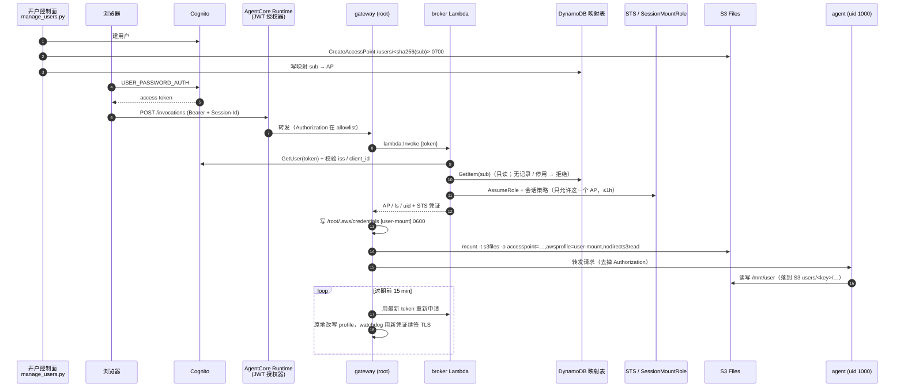

# 设计说明：AgentCore Runtime × S3 Files 按用户隔离的持久化存储

本文解释这套参考架构里每个设计决策是怎么来的。

起点是 [walkley/acruntime-s3files-isolation](https://github.com/walkley/acruntime-s3files-isolation)（下称 walkley）。它按 **session** 隔离：broker Lambda 签发只能挂一个 access point 的凭证；文件系统资源策略兜底；执行角色零权限。本方案保留它的隔离根基，改成按**用户**隔离：AP 在开户时创建，容器内由 root gateway 在首个请求里申请凭证并挂载，agent 降权运行，凭证定期轮换。同时刻意做了减法：不做 page pin，不做 SQLite/Litestream。

---

## 1. 要解决的问题

AgentCore Runtime 的每个 session 是一台独立的 microVM，但同一个 Runtime 下所有 session 共用**一个执行角色**。执行角色的凭证经 microVM 元数据服务（MMDS）下发，VM 里任何代码都拿得到，包括大模型生成的工具代码。所以：

- 给执行角色 S3 权限，任何一个 session 都能读到所有用户的数据；
- 只靠应用层做路径检查也不可靠，因为 agent 会执行不可信代码。

另外，`filesystemConfigurations` 绑定在 Runtime 上，对所有 session 一致生效，没法按用户换 access point。

目标是同时满足四点：

1. 数据放在客户自己的 S3 桶；
2. 按**用户**隔离，数据跨 session、跨 microVM 保留；
3. 隔离由服务端（IAM + S3 Files）强制执行，不依赖 agent 代码是否可信；
4. 结构足够简单，能当客户参考架构。

## 2. 端到端流程



## 3. 关键设计决策

| # | 决策 | 为什么 |
|---|---|---|
| 1 | 每个用户一个 access point，根目录 `/users/<sha256(sub)>`，`creationPermissions=0700`，`posixUser=1000:1000` | 由服务端把用户限定在自己的目录里，不靠应用拼路径。用哈希做目录名，用户 id 里的特殊字符进不了路径，两个 id 也不会被清洗成同一个目录 |
| 2 | AP 在**开户时**由控制面创建，映射（sub → AP）写进 DynamoDB；broker 只读这张表 | 冷启动路径上不调用 S3 Files 控制面；broker 和容器都不需要"建 AP"的权限；管理员能集中查看、停用、删除用户的存储 |
| 3 | 用户身份来自 **Cognito JWT**，在两处校验：入口处由 AgentCore JWT 授权器校验，broker 里再用 `GetUser` 加 iss/client_id 校验一次 | 如果身份只是调用方放进自定义 header 的一个字符串，它可信与否就全靠"只有上游服务能调用 runtime"这个前提。用 JWT，客户端伪造不了身份。broker 不信任调用方（执行角色谁都拿得到），只信 token |
| 4 | **由 JWT 充当 walkley 的 KMS 票据** | 两者作用相同，都是 VM 拿来向 broker 证明"我在为谁服务"的东西。JWT 由 IdP 签发，泄漏也只影响这个用户自己，和 walkley 票据的安全边界一样，但少了一套 KMS 签票流程 |
| 5 | broker 签凭证时用会话策略把权限限定为 `s3files:AccessPointArn == 该用户 AP` | 拿到的凭证只能挂这一个 AP，换别的 AP 会被 IAM 拒绝（同 walkley） |
| 6 | 文件系统资源策略：对不经 AP 的 `ClientMount/ClientWrite/ClientRootAccess` 一律 Deny | 兜底。即使以后有人误给某个角色加了 `s3files:Client*`，也挂不了根目录（同 walkley） |
| 7 | 执行角色**零** S3 / S3 Files 权限，只能调 broker、Bedrock、写日志 | 执行角色要按"VM 里任何代码都拿得到"来设计（同 walkley） |
| 8 | `nodirects3read`，SessionMountRole 不给 `s3:GetObject` | 所有数据都走 NFS 路径，由上面的 AP 授权管住（同 walkley） |
| 9 | **gateway 以 root 运行**，负责申请凭证、挂载、轮换、绑定用户；**agent 以 uid 1000 运行** | 需要 root 的存储和凭证工作，和执行不可信代码的 agent 分在两个进程。agent 读不到 `/root/.aws/credentials`，不能 mount，也不能 ptrace gateway |
| 10 | agent 在 import 之前就降权：`setresgid → setresuid`，再设 `PR_SET_NO_NEW_PRIVS`；降权失败直接退出 | 先改 gid 再改 uid，顺序不能反。`NO_NEW_PRIVS` 让 setuid 程序（`mount`、`su`）也回不到 root。降权失败就不启动，绝不以 root 继续跑 |
| 11 | gateway 是 agent 的唯一入口：挂载完成前不转发任何请求 | 保证挂载前不碰用户路径，不需要额外的信号文件协议。agent 进程在开机时就起好、import 完成，V2 快照会把这部分包含进去 |
| 12 | 一台 microVM 只绑定一个用户：首个请求的 `sub` 被记下，之后 `sub` 不同的请求一律 403（在挂载锁里还会再核对一次，防止两个用户的首个请求并发抢同一个 session） | session id 只是一个字符串。不要把"一个 VM 只服务一个用户"完全交给上游路由，加这条检查几乎没有成本 |
| 13 | 签不出凭证或挂载失败时，返回 503、不服务，绝不退回执行角色，也不退回本地盘 | 退回执行角色等于放弃隔离；写到本地盘的数据会随 microVM 回收而丢失 |
| 14 | STS 凭证最长 1 h（role chaining 的上限）。按实际过期时间，在过期前 `min(15 min, 剩余/4)` 原地改写 profile，不重新挂载 | watchdog 续签 TLS 时会重新读这个 profile。凭证以静态 key 写进只有 root 能读的文件，由 gateway 单点改写，不需要在镜像里放一个能换凭证的 helper（walkley 用的是 `credential_process`，两种都可行） |
| 15 | 轮换用"最近一次请求带来的 token"；如果上次轮换失败，下一个请求一到就立即重试 | broker 只认 token，而 token 由浏览器负责刷新。session 空闲超过 15 min 就会被回收，所以只要 session 还活着，最近一次请求就在 15 min 以内 |
| 16 | Runtime 用 **PlatformVersion V2** | V2 从快照恢复 microVM，gateway 和 agent 的启动、import 在快照之前就完成了 |

## 4. 容器内的进程

```
entrypoint.sh (root)
├─ watchdog supervisor (root) → amazon-efs-mount-watchdog   维持 TLS 隧道；用轮换后的凭证续签
├─ efs-utils 日志转发 → stdout                               CloudWatch 只收 stdout
├─ agent_app.py → 降权到 uid 1000 + NoNewPrivs → Strands Agent（127.0.0.1:8081）
└─ gateway.py (root, :8080)                                  /ping、/invocations；申请凭证 → 挂载 → 轮换 → 代理
     └─ mount.s3files → efs-proxy (root)                      TLS + IAM，挂载期间常驻
```

## 5. 凭证一览

| 凭证 | 在哪 | 谁能用 | 有效期 | 说明 |
|---|---|---|---|---|
| 用户 access token（Cognito JWT） | 浏览器 sessionStorage；gateway 进程内存 | 用户本人；gateway 拿它找 broker 换凭证 | 60 min，前端用 refresh token 续期 | 在 AgentCore 入口和 broker 各校验一次；转发给 agent 前去掉 |
| 执行角色凭证 | MMDS | VM 内任何进程 | 平台管理 | 没有 S3 / S3 Files 权限；能调 broker，但没有 token 换不到任何东西 |
| 挂载用 STS 凭证 | `/root/.aws/credentials [user-mount]`，权限 0600 | gateway、mount helper、watchdog（都是 root） | ≤ 1 h，过期前轮换 | 会话策略只允许挂本用户的 AP |
| SessionMountRole 完整凭证 | 只在 broker 内部 | broker | — | 不出 Lambda；信任策略只允许 broker 角色 assume |

## 6. 攻击路径与拦截层

假设攻击者控制了 alice 的 agent，能以 uid 1000 执行任意代码：

| 尝试 | 结果 | 拦截层 |
|---|---|---|
| 读 `/root/.aws/credentials` | Permission denied | OS 权限（非 root） |
| 自己 `mount` 别的 AP | 失败 | 非 root + NoNewPrivs |
| 从 MMDS 拿执行角色，直接读 S3 桶 | AccessDenied | 执行角色零 S3 权限 |
| 用执行角色调 S3 Files 控制面 | AccessDenied | 执行角色零 S3 Files 权限 |
| 用执行角色调 broker，不带 token 或带伪造 token | `unauthorized` | broker 只认有效的 Cognito token |
| 拿 bob 的 session id 发请求 | 拿不到，AgentCore 只路由到 bob 自己的 microVM | — |
| 用 bob 的 token 打到 alice 的 session | 403 | gateway 用户绑定 |

如果攻击者拿到了 alice 这台 VM 的 root（比如平台层漏洞，或者直接用 alice 自己的 JWT 调 `InvokeAgentRuntimeCommand`，它以 root 执行命令），能拿到 alice 的挂载凭证，但（`scripts/root_attack_test.py` 已实测，均被服务端返回 `access denied by server`）：

| 尝试 | 结果 | 拦截层 |
|---|---|---|
| 用 alice 的凭证挂 bob 的 AP | 拒绝 | 会话策略 `s3files:AccessPointArn` |
| 用 alice 的凭证挂文件系统根目录 | 拒绝 | 文件系统资源策略 Deny |
| 用 alice 的 token 找 broker 换凭证 | 换到的仍是 alice 的 | broker 按 token 里的 sub 查映射 |

能拿到的最多就是 alice 自己的数据。这和 walkley 文档里"票据泄漏只影响本 session"是同一条安全边界。

## 7. 和 walkley 方案的对照

| 维度 | walkley | 本方案 |
|---|---|---|
| 隔离单位 | session（换 session 看不到之前的数据） | 用户（数据跨 session 保留） |
| 谁建 AP | broker，首次挂载时按需；session 结束后回收 | 开户控制面（`manage_users.py`），开户时；销户时删除 |
| 用户 → AP 映射 | 由 sid 确定性推出 | DynamoDB 表，broker 只读；支持停用 / 恢复 |
| 身份怎么进容器 | KMS 签名票据，`/dev/shm` | Cognito JWT（AgentCore 授权器 + broker 两次校验），只在 gateway 进程内存里 |
| 谁签凭证 | broker Lambda | broker Lambda（会话策略写在代码里，可审计） |
| 挂载时机 | 带外：控制面用 `InvokeAgentRuntimeCommand` 下发命令挂载 | 带内：首个请求里由 gateway 挂载，不依赖控制面先发命令 |
| 挂载凭证形式 | `credential_process`，15 min | 静态 key，1 h，提前 15 min 原地改写 |
| VM 内权限 | agent 以 root 运行，隔离完全靠 IAM | gateway 用 root，agent 用 uid 1000 + NoNewPrivs，多一层 OS 防护 |
| 文件系统资源策略 / 执行角色零权限 / nodirects3read | 有 | 有（保持不变） |
| 同一 VM 多用户检查 | 不适用 | 有（403） |

## 8. 刻意没做的事（生产化时再考虑）

| 项 | 为什么这次不做 | 生产建议 |
|---|---|---|
| V2 page pin | 为保持简单先不做。代价是从 V2 快照恢复后，挂载工具要冷读文件，首次挂载会多花几秒，长尾更久 | 构建期生成挂载工具的文件清单；在开始监听端口（即平台打快照）之前，用一个常驻进程把这些文件 mmap 住，让它们进入内存快照 |
| SQLite / Litestream | 本 demo 的 agent 只读写普通文件 | NFS 上不要跑 SQLite 的 WAL。数据库放本地盘，用 Litestream 复制到同一个桶里挂载看不到的前缀，再加单写者锁，防止新旧 VM 同时上传 |
| 同一用户多个并发 session | demo 不限制。两台 VM 同时挂同一个 AP 时，同名文件会互相覆盖 | 由控制面保证一个用户同一时间只有一个活跃 session，或者在用户目录下按 session 分子目录 |
| AP 配额（约 1 万个 / 文件系统） | demo 用户少 | 映射表里已经存了 `fileSystemId`。用户多了就分成多个文件系统，broker 读到哪个就挂哪个 |
| token 长时间不更新 | 浏览器空闲超过 token 有效期后，后台轮换会失败；session 空闲 15 min 也会被回收 | 现在的实现会在下一个请求到达时立即重试。真正要长时间无人值守的话，可以让 broker 换回一张短期票据（walkley 的思路） |
| 网络层挡住 MMDS | 不可信代码仍然能拿到执行角色凭证（权限已压到最小） | 把工具代码放进单独的网络命名空间，用 iptables 挡掉元数据端点 |
| `exec` 调试接口 | e2e 测试要用它模拟"不可信代码"。它对所有登录用户开放，权限和 agent 的 `run_shell` 工具相同（uid 1000，只能碰自己的数据） | 生产删掉，或用环境变量开关、默认关闭 |
| S3 桶只允许 TLS | 两个桶都已 Block Public Access；数据桶只由 S3 Files 服务角色访问，前端桶只由 CloudFront OAC 访问 | 再加一条桶策略：`aws:SecureTransport` 为 false 时 Deny |
| 前端安全响应头 / WAF | demo 不做 | CloudFront 挂托管的 SecurityHeadersPolicy（含 CSP、HSTS），按需加 AWS WAF |
| 依赖版本 | `requirements.txt` 用 `>=` | 固定版本并开启依赖扫描；容器基础镜像固定 digest |
