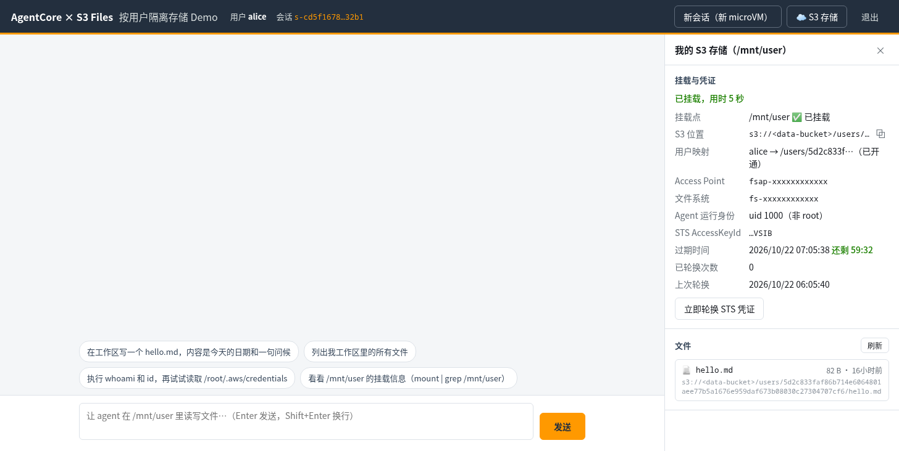
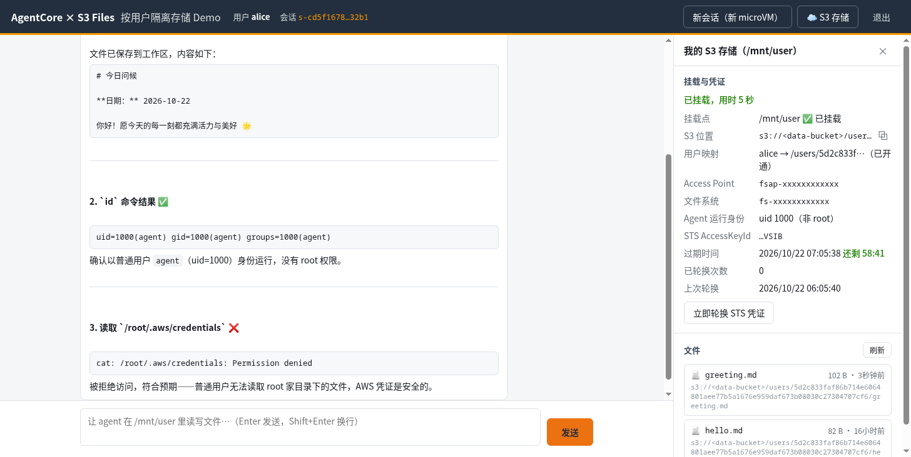
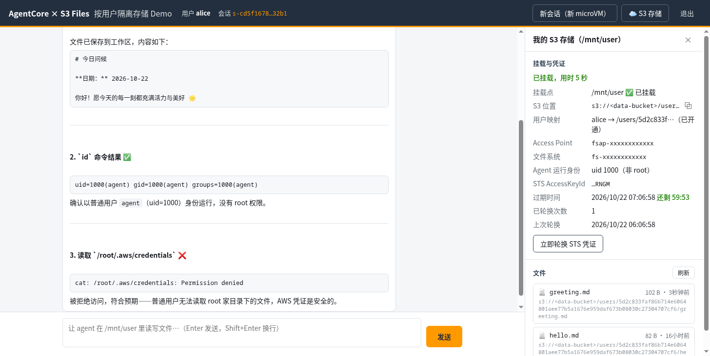
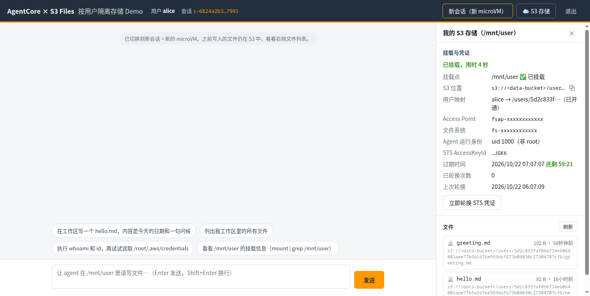
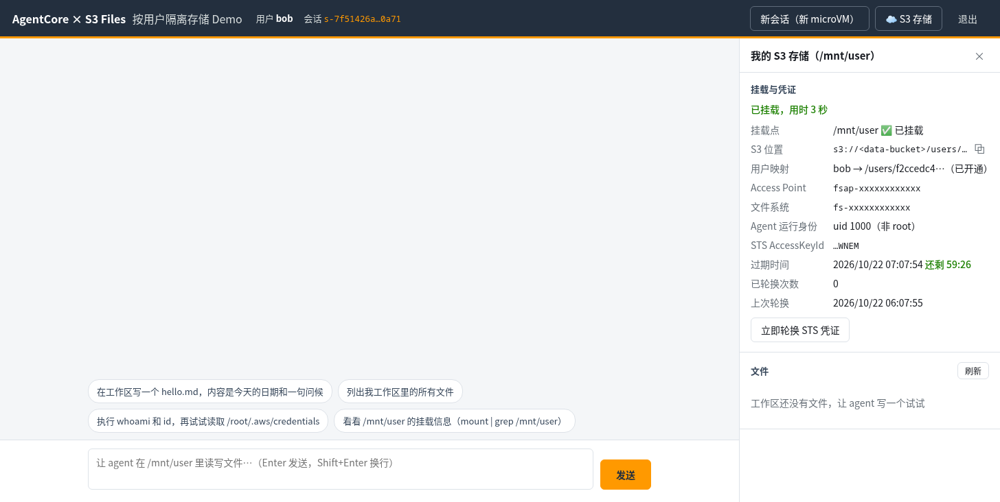

# 端到端测试报告

测试时间：2026-10-21　环境：一个 AWS 测试账号 / us-west-2，Runtime `s3files_user_agent-<id>`（PlatformVersion V2，VPC 模式，JWT 授权器），前端为 CloudFront 地址（已从公开版中移除）

## Situation（背景）

同一个 AgentCore Runtime 下所有 session 共用一个执行角色，VM 内任何代码都能从 MMDS 拿到它。本参考架构要证明：在 agent 会执行不可信代码的前提下，每个用户只能读写自己在 S3 上的数据，数据能跨 session 保留，并且用于挂载的 STS 凭证能被申请、限定范围、自动轮换和吊销。

## Task（要验证什么）

1. 登录与入口认证：没有 token 或 token 被篡改时，进不了 Runtime。
2. 用户 ↔ AP 映射：开户时写入，broker 只读；没开户或已停用的用户拿不到凭证。
3. agent 非 root：读不到凭证文件、不能 mount、读不到 gateway 进程的环境。
4. 跨用户隔离：文件不可见；session 不可冒用；并发抢占同一个 session 时也不出错。
5. 执行角色攻击面：拿到执行角色也读不了桶、调不了 S3 Files、换不到挂载凭证。
6. 最坏情况：在 VM 里拿到 root、持有 alice 的凭证，也挂不了 bob 的 AP 或根目录。
7. STS 凭证：有效期 ≤ 1 h；能手动和自动轮换；轮换不中断挂载；首份凭证过期后仍可用；watchdog 续签 TLS 时用的是新凭证。
8. 持久化：换 session（换 microVM）数据仍在；数据落在自有 S3 桶。
9. UI：浏览器直连 Runtime，侧边栏能展示挂载内容。

## Action（怎么测）

| 脚本 / 方法 | 覆盖 | 方式 |
|---|---|---|
| `scripts/e2e_test.py` | 1–5、7（手动轮换）、8，以及大模型对话 | 通过 HTTPS 直连 Runtime，与浏览器的调用方式相同。用户 e2e-alice / e2e-bob 由 `manage_users.py` 开户 |
| `scripts/root_attack_test.py` | 6 | 用 `InvokeAgentRuntimeCommand` 在 alice 的 session 里以 root 执行 mount |
| `scripts/rotation_soak_test.py` | 7（自动轮换、watchdog 续签） | 不做任何手动轮换。28 分钟一轮（TTL 900 s），70 分钟一轮（TTL 3600 s，并读取 TLS 证书里嵌的 AccessKeyId） |
| AgentCore Browser（agentcore-browser skill） | 9 | 对线上 CloudFront 地址，依次登录 alice → 对话写文件 → 轮换 → 新会话 → 换 bob 登录，并截图 |
| CloudWatch 日志 | 冷启动耗时 | 统计 gateway 的 `mounted` 事件 |

## Result（结果）

### e2e_test.py：33 / 33 通过

| 分组 | 检查项 | 结果 |
|---|---|---|
| 映射 | 映射表里 alice / bob 各有一个 active 的 AP | ✅ |
| 映射 | 已登录但没开户的用户 → 拒绝挂载（`no storage provisioned`） | ✅ |
| 入口 | 无 token → 401；篡改 token → 401 | ✅ ✅ |
| 挂载 | alice 冷启动挂载成功；AP 根目录为 `/users/<sha256(sub)>` | ✅ ✅ |
| 非 root | uid/gid = 1000，NoNewPrivs = 1 | ✅ |
| 非 root | `cat /root/.aws/credentials` → Permission denied | ✅ |
| 非 root | `mount` → must be superuser | ✅ |
| 非 root | `cat /proc/1/environ`（gateway）→ Permission denied | ✅ |
| 持久化 | 写入 `notes/alice.txt`，list_files 能看到 | ✅ ✅ |
| 隔离 | bob 的 AP 与 alice 不同；bob 看不到 alice 的文件；bob 全盘搜索也找不到 alice 的内容 | ✅ ✅ ✅ |
| 绑定 | bob 的 token 打到 alice 的 session → gateway 403 | ✅ |
| 绑定 | alice 和 bob 并发抢同一个新 session → 一个成功、另一个 403 | ✅ |
| 执行角色 | 不带 token 或带伪造 token 调 broker → unauthorized | ✅ ✅ |
| 执行角色 | 直接读数据桶 → AccessDenied；调 S3 Files 控制面 → AccessDeniedException | ✅ ✅ |
| broker | 按映射表返回 alice 的 AP；凭证有效期 3599 s（≤ 1 h） | ✅ ✅ |
| 轮换 | 手动 rotate 后 AccessKeyId 变化、次数 +1；轮换后挂载照常可写 | ✅ ✅ |
| 吊销 | disable 后轮换被 broker 拒绝、新会话无法挂载；enable 后轮换恢复 | ✅ ✅ ✅ |
| 持久化 | alice 新会话（新 microVM）能看到之前的文件，内容一致 | ✅ ✅ |
| S3 | `s3://<bucket>/users/<sha256(sub)>/notes/alice.txt` 可见 | ✅ |
| 对话 | chat 流式返回并调用 `write_file`；`hello.md` 出现在工作区 | ✅ ✅ |

### root_attack_test.py：5 / 5 通过

| 以 root 在 alice 的 VM 里，用 alice 的凭证 | 结果 |
|---|---|
| `InvokeAgentRuntimeCommand` 执行 `id -u` | `0`（确实是 root） |
| 对照组：挂 alice 自己的 AP | 挂载成功，能看到 `hello.md`、`notes/` |
| 挂 bob 的 AP | `mount.nfs4: access denied by server`（会话策略） |
| 不经 AP 挂文件系统根目录 | `mount.nfs4: access denied by server`（文件系统策略） |

### rotation_soak_test.py

**28 分钟，TTL 900 s：4 / 4 通过。** 全程没有手动轮换。

| 时间（UTC） | AccessKeyId | 自动轮换次数 | 凭证过期 | 写入 |
|---|---|---|---|---|
| 14:31 挂载 | …STTS | 0 | 14:46:22 | ok |
| 14:42:39 | …XKTQ | 1 | 14:57:39 | ok |
| 14:47:28（首份凭证已过期） | …XKTQ | 1 | 14:57:39 | ok |
| 14:53:55 | …SVS6 | 2 | 15:08:55 | ok |
| 14:59:31 | …SVS6 | 2 | 15:08:55 | ok |

结论：轮换发生在剩余时间的 1/4 处，也就是 900 s 凭证在第 11.25 分钟时；首份凭证过期 13 分钟后挂载仍可写，lastError 为空。

**70 分钟，TTL 3600 s（watchdog 续签 TLS 时用的是哪份凭证）：5 / 5 通过。** 通过 `InvokeAgentRuntimeCommand` 以 root 读取 efs-utils 的客户端证书，取出扩展 `1.3.6.1.4.1.4843.7.2` 里签名用的 AccessKeyId。

| 时间（UTC） | 事件 | gateway 的 AccessKeyId | TLS 证书 notBefore | 证书里的 AccessKeyId | 写入 |
|---|---|---|---|---|---|
| 15:17 | 挂载 | …ZJHH（16:17:17 过期） | 15:02:17 | …ZJHH | ok |
| 16:02:18 | 后台自动轮换（剩余 15 min 时） | …HSHK（17:02:18 过期） | — | — | ok |
| 16:17:17 | 首份凭证过期 | …HSHK | — | — | ok |
| 16:29:38 | soak 结束时读证书 | …HSHK | **16:02:17**（watchdog 已续签） | **…HSHK** | ok |

结论：watchdog 的 60 分钟续签读取的是 gateway 原地改写后的 profile，新证书由轮换后的凭证签名。整个过程没有重新挂载，写入一直正常。efs-utils 签证书时会把 notBefore 往前倒推，所以 notBefore 早于实际续签时刻。

### 浏览器端到端测试（AgentCore Browser）

| 步骤 | 结果 | 截图 |
|---|---|---|
| alice 登录，侧边栏显示挂载、S3 位置、映射、AP、uid 1000、凭证倒计时 | ✅ |  |
| 对话写文件并执行 `id` 和读凭证：文件出现在侧边栏并标注 S3 key；`uid=1000`、`Permission denied` | ✅ |  |
| 点「立即轮换 STS 凭证」：key 变化，次数 0 → 1 | ✅ |  |
| 「新会话（新 microVM）」：重新挂载后之前的文件仍在 | ✅ |  |
| 换 bob 登录：AP 和 S3 前缀不同，文件列表为空 | ✅ |  |

另外确认：浏览器直接调用 `bedrock-agentcore` 数据面时，带 `Authorization` 和 `X-Amzn-Bedrock-AgentCore-Runtime-Session-Id` 两个头的 CORS 预检能通过。

### 冷启动耗时（CloudWatch，13 次挂载）

| 阶段 | 中位数 | 范围 |
|---|---|---|
| broker 签发凭证（mint） | 218 ms | 171 ms – 1.9 s（Lambda 冷启动） |
| `mount -t s3files` | 0.94 s | 0.77 s – 37.6 s |

挂载的长尾（7.8 s / 17 s / 37.6 s）都出现在 Runtime 新版本之后的头几次。其中最长的一次，日志显示第一次 NFS mount 15 s 超时后重试才成功。原因是 V2 从快照恢复后挂载工具要冷读文件，可以用 page pin 缓解，本 demo 没做。

### 测试中发现并已修复的问题

| 问题 | 修复 |
|---|---|
| gateway 返回的 403/503/502 被 AgentCore 包装成 424，响应体丢失，前端无法显示原因 | 业务错误改为 HTTP 200 + `{"error","status"}` |
| 代码审查发现：两个用户的首个请求并发进入一个未绑定的 VM 时，第二个请求在锁里直接返回 | 在锁内再核对一次 `sub`，不一致就 403。实测发现 AgentCore 本身也会对并发创建同一个 session 的第二个请求返回 409 |
| watchdog 每秒报 `read_ahead_kb` 修改失败（/sys 只读） | 镜像里设 `optimize_readahead = false` |
| 模型回复里的 Markdown 原样显示 | 前端增加代码块、标题、分隔线的安全渲染；system prompt 要求不用表格 |

> 公开版截图里的桶名、Access Point / 文件系统 ID 已替换为占位符。
